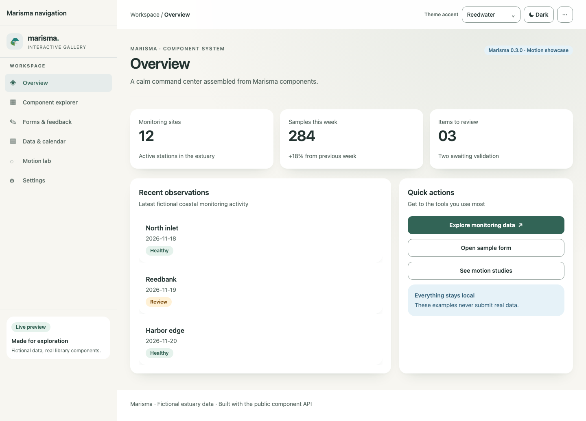
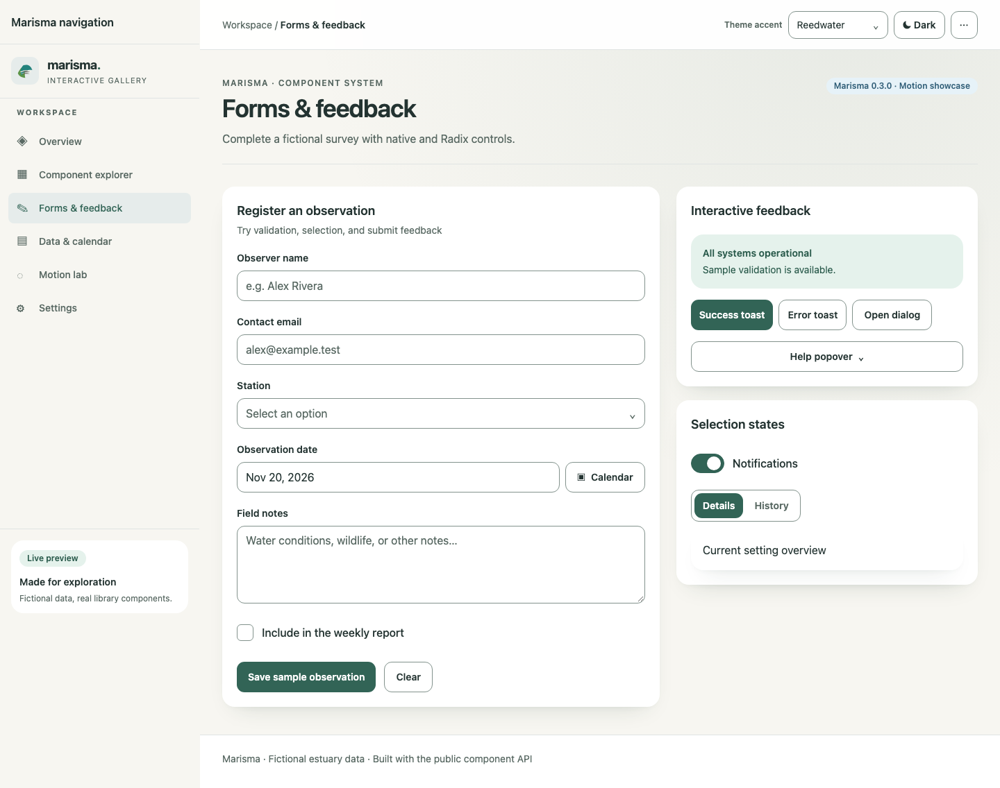
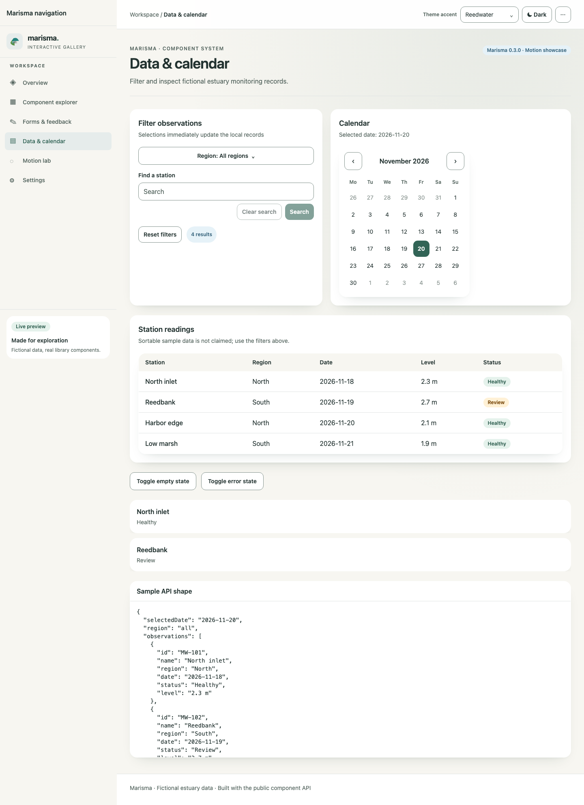
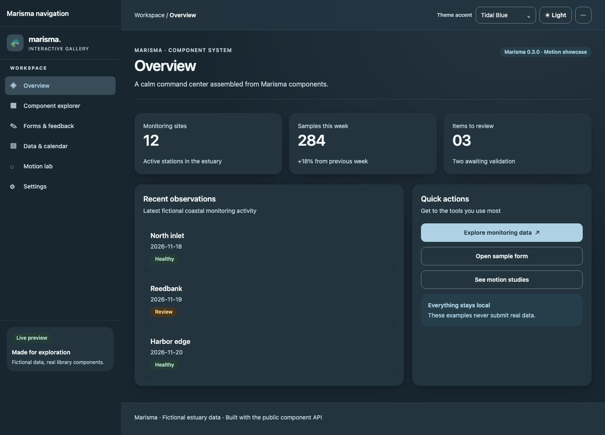
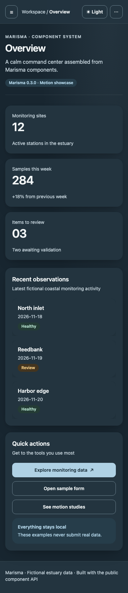

<div align="center">


# Marisma

**Calm, capable React components for real applications.**

48 component families · React 19 · TypeScript · Tailwind CSS 4

[**Explore the live showcase**](https://marisma.darizae.dev) · [npm](https://www.npmjs.com/package/@darizae/marisma) · [Source](https://github.com/darizae/marisma)

</div>



Marisma is a UI library for building dashboards, forms, and data-rich applications without starting each interaction from scratch. Its **Soft Elevation** design uses gentle depth, clear focus states, and restrained motion. Choose between **Reedwater** and **Tidal Blue**, each in light or dark mode.

The [interactive showcase](https://marisma.darizae.dev) is a real React application with fictional data: explore the components, try forms and filters, switch themes, and inspect motion behaviors. It does not require an account or connect to a backend.

## Inside the showcase

| Forms & feedback | Data & calendar |
| --- | --- |
|  |  |

| Tidal Blue · dark | Phone layout |
| --- | --- |
|  |  |

Also try the [48-family component explorer](https://marisma.darizae.dev/#/explorer) and [motion lab](https://marisma.darizae.dev/#/motion). The showcase illustrates representative states; the package source and Storybook are the reference for complete component APIs.

## Get started

Install the published library:

```bash
pnpm add @darizae/marisma react react-dom tailwindcss
```

In your Tailwind CSS entry file (adjust the relative `@source` path to match your project):

```css
@import "tailwindcss";
@import "@darizae/marisma/theme.css";
@source "../node_modules/@darizae/marisma/dist";
```

Set an accent and mode on the element containing your components:

```tsx
import { Button, Card, CardContent, CardHeader, CardTitle } from "@darizae/marisma";

export function Example() {
  return (
    <div data-marisma-accent="reedwater" data-marisma-mode="light">
      <Card>
        <CardHeader><CardTitle>Your workspace</CardTitle></CardHeader>
        <CardContent><Button onClick={() => alert("Ready!")}>Get started</Button></CardContent>
      </Card>
    </div>
  );
}
```

Marisma supplies the components and styles, not routing, authentication, data fetching, or theme persistence. Overlays use accessible Radix primitives; keyboard and reduced-motion behavior are part of the design.

## Develop locally

Requires **Node.js 22.18+** and **pnpm 11.9**:

```bash
pnpm install --frozen-lockfile
pnpm build
pnpm dev:showcase     # http://127.0.0.1:4178
```

For component documentation, run `pnpm dev:storybook` (port 6006). Other useful commands:

```bash
pnpm typecheck
pnpm --filter @marisma/showcase test:browser
pnpm --filter @marisma/showcase build
```

The published package lives in `packages/ui/`; `apps/showcase/` is the interactive app, `apps/storybook/` holds component references, and `apps/consumers/` verifies packaged Vite/Next.js integration. To refresh the README screenshots, run `pnpm --filter @marisma/showcase exec playwright test tests/readme-shots.spec.ts` after building.

**Using a coding agent?** Start with [the agent setup prompt](AGENT_SETUP_PROMPT.md) and [repository instructions](AGENTS.md). Architectural decisions and release checks are in [docs/planning](docs/planning/APPROVED_DECISIONS.md).

## License

[MIT](LICENSE) · Latest published package: **0.3.0**.
