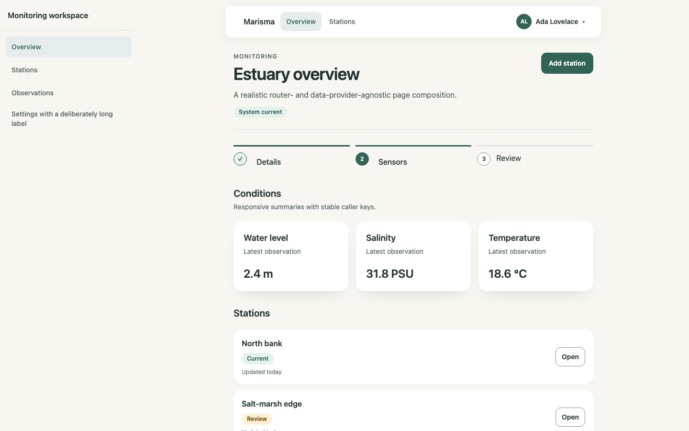
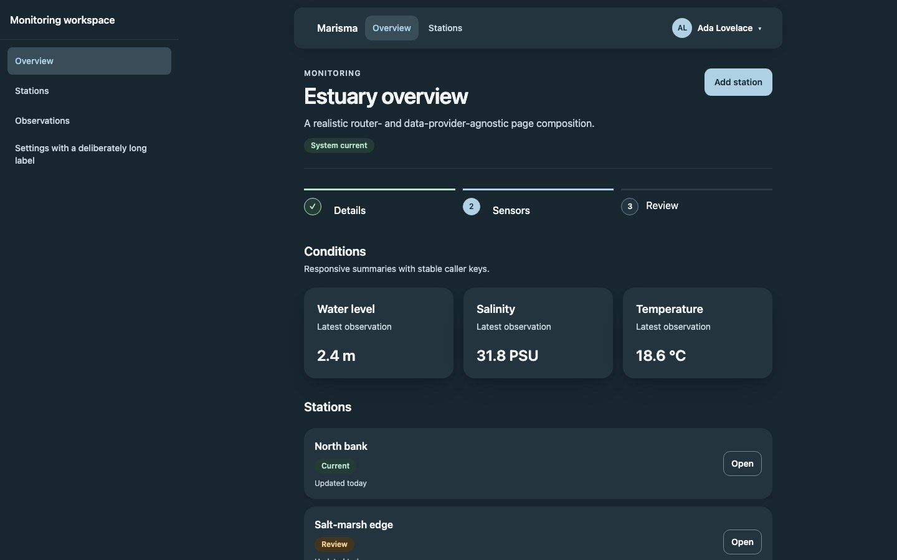
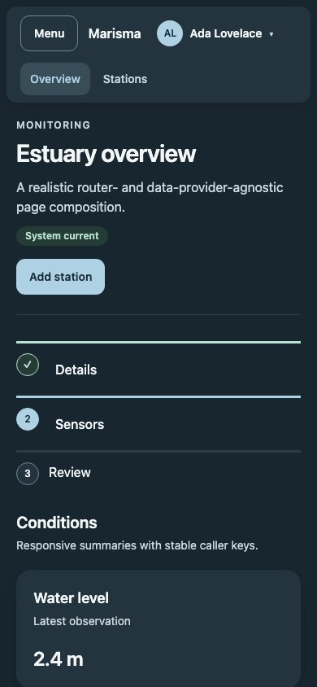

# Marisma


A Tailwind-first React component library for professional web applications.

Marisma is a public library for React 19 and Tailwind CSS 4. The current
package implements 48 different component families with typed
public APIs, accessible native or Radix-based interactions, and Reedwater and
Tidal Blue themes in light and dark modes.

> **Latest release:** [`@darizae/marisma@0.3.0`](https://www.npmjs.com/package/@darizae/marisma/v/0.3.0) is publicly published and independently verified against the owner-approved SHA-256 package archive. Versions 0.1.0 and 0.2.0 remain available.

## Install

```bash
pnpm add @darizae/marisma react react-dom tailwindcss
```

## Soft Elevation (0.2.0)

Soft Elevation is the default visual direction from `@darizae/marisma@0.2.0` onward. Cards and data surfaces use 18px radii and restrained theme-specific shadows; controls retain distinct boundaries and visible keyboard focus. Reedwater and Tidal Blue each support light and dark mode. No `data-marisma-style` opt-in is required.

`0.2.0` is published (source `fc3dc39d…`, artifact SHA-256 `8f4b9318…80852`, verified by `priv/release/postpublish.sh`). See [local verification and release](docs/planning/VERIFICATION_AND_RELEASE.md).

Captured from actual React rendering (see the [parity matrix](docs/design/UI_UX_PARITY_MATRIX.md) for the full evidence ledger):





## Available components

- `Button` — primary, secondary, and ghost variants; three sizes; disabled and
  loading states.
- `Input` — native controlled or uncontrolled input with a visible label,
  supporting description, validation message, and forwarded native props.
- `Dialog` — composable Radix dialog primitives with modal focus containment,
  Escape dismissal, focus restoration, and automatic subtree-theme bridging
  for its portal.
- Presentation — `Alert`, `Avatar`, `Badge`, `ButtonGroup`, `Card` slots,
  `Label`, `Separator`, and `Spinner`.
- Feedback and utilities — `CopyCode` with clipboard failure feedback,
  focusable native `ScrollArea`, and dependency-free `ToastProvider`,
  `ToastAction`, and `useToast` exports.
- Selection and disclosure — `Checkbox`, `Switch`, `RadioGroup`,
  `ToggleGroup`, `Collapsible`, and native `Textarea`, including controlled,
  uncontrolled, disabled, read-only, invalid, and indeterminate states where
  applicable.
- Overlays and navigation — portalled `Popover`, `Tooltip`, and nested
  `DropdownMenu` primitives plus `Tabs`, with Radix keyboard/focus behavior and
  automatic nearest-subtree theme bridging.
- Complex selection and dates — single-value, non-searchable `Select`, a
  keyboard date-grid `Calendar`, and composed `DateField`.
- Forms and composed fields — native `Form`, `FieldGroup`, `FieldDivider`, and
  `FieldCallout`; guarded `ConfirmationDialog`, `InlineEdit`, and `SearchField`
  interactions; and `Dropzone` for validated local file selection.
- Data and content — semantic compound `Table`, caller-keyed `RecordList`,
  responsive `CardGrid`, capped text-only `DataPreview`, and `PageSection`.
- Navigation and application layout — responsive `Sidebar`, `AppNavbar`,
  `AppShell`, `PageFooter`, and `StepProgress`, with native or consumer link
  components and no required router.
- Page patterns — `PageHeading`, caller-owned `UserMenu`, and `ErrorView`.

Storybook includes controls, keyboard notes, interaction coverage, and theme
switching for these components. No routing, data fetching,
authentication, or persisted theme settings are included.

## Interactive showcase (0.3.0)

The new standalone React application at [`apps/showcase/`](apps/showcase/) demonstrates navigation, forms, filters, calendar selection, data views, motion studies, and theme switching. Start locally using `pnpm dev:showcase` and open **http://127.0.0.1:4178/** on the same Mac while the server is running. The URL is not a public deployment; it stops responding when the dev process exits. The searchable explorer accounts for all 48 catalog families and links to their Storybook references when `pnpm dev:storybook` is running separately on port 6006. See [showcase usage and coverage](apps/showcase/README.md) and the [motion vocabulary](docs/motion/MOTION_SYSTEM.md).

Version 0.3.0 introduces measured motion, animated fields, compact accessible toast stacks, and the canonical leaf favicon; previous published versions remain unchanged. The release was qualified from the exact source commit and npm archive, with interactive owner 2FA.

## Development checkout

The monorepo requires Node.js 22.18.0 or newer and pnpm 11.9.0. The 22.18
floor is verified directly and matches the current package build tool.

```bash
pnpm install --frozen-lockfile
pnpm build
pnpm dev:storybook
```

The tracked package manifest stays private. To exercise the exact packed
artifact locally, use the repository's independent Vite and Next.js acceptance
harness:

```bash
pnpm --filter @marisma/storybook test:consumers
```

## Tailwind CSS 4 setup

Import Tailwind once, then the Marisma theme, then register the installed
package's compiled JavaScript as a source. The `@source` path is relative to the
CSS file, so adjust it if your stylesheet lives elsewhere.

```css
@import "tailwindcss";
@import "@darizae/marisma/theme.css";
@source "../node_modules/@darizae/marisma/dist";
```

Set both theme attributes on the scope that owns the components:

```html
<div data-marisma-accent="reedwater" data-marisma-mode="light"></div>
```

Supported values are `reedwater | tidal-blue` and `light | dark`. Marisma does
not store or switch those values for the consumer.

## Button, Input, and Dialog example

This is the same compiled example rendered in Storybook.

<!-- marisma-example:start -->

```tsx
"use client";

import { useState } from "react";
import {
  Button,
  Dialog,
  DialogClose,
  DialogContent,
  DialogDescription,
  DialogTitle,
  DialogTrigger,
  Input,
} from "@darizae/marisma";

export function MarismaExample() {
  const [name, setName] = useState("Marisma");
  const [status, setStatus] = useState("No changes saved");

  return (
    <section className="grid w-full max-w-lg gap-5 rounded-mar-card border border-mar-surface-border bg-mar-card shadow-mar-card p-6">
      <Input
        description="This value is controlled by your application."
        label="Project name"
        onChange={(event) => setName(event.currentTarget.value)}
        value={name}
      />
      <div className="flex flex-wrap gap-3">
        <Button onClick={() => setStatus(`Saved ${name}`)} type="button">
          Save changes
        </Button>
        <Dialog>
          <DialogTrigger variant="secondary">Open details</DialogTrigger>
          <DialogContent>
            <DialogTitle>Project details</DialogTitle>
            <DialogDescription>
              Dialogs keep focus contained until they close.
            </DialogDescription>
            <DialogClose>Done</DialogClose>
          </DialogContent>
        </Dialog>
      </div>
      <p aria-live="polite" className="text-sm text-mar-muted">
        {status}
      </p>
    </section>
  );
}
```

<!-- marisma-example:end -->

## Repository structure

- `packages/ui/` — the published React component source and Tailwind theme
- `apps/storybook/` — component documentation, interactions, and visual checks
- `apps/showcase/` — six-page interactive example app, component explorer and motion lab
- `apps/landing/` — public introduction and component preview
- `apps/consumers/vite-react/` — independent packed Vite fixture
- `apps/consumers/nextjs/` — independent packed Next.js App Router fixture

## Brand

Marisma's supplied leaf mark is stored once at [`assets/brand/marisma-leaf.svg`](assets/brand/marisma-leaf.svg). The landing page and Storybook serve this canonical file as their logo and SVG favicon. The visual direction is calm, coastal-estuary modernism, expressed through Reedwater and Tidal Blue themes; the brand mark does not impose a consumer font or application theme. Approved product decisions and asset usage are documented in [`docs/planning/APPROVED_DECISIONS.md`](docs/planning/APPROVED_DECISIONS.md).

## Implementation status and local verification

The [local release-candidate report](docs/release/T-011_RELEASE_CANDIDATE.md) preserves the historical qualification evidence.

The completed implementation and release-task Markdown files were retired from
the working tree; **Git history** retains their full content.
Maintainers should use [approved decisions](docs/planning/APPROVED_DECISIONS.md),
the [engineering contract](docs/planning/ENGINEERING_CONTRACT.md), and [current
source/test routing](docs/agent/ROUTING.md) instead of executing obsolete task
files.

**Tests run locally.** GitHub Actions is not a required validation gate. Use targeted tests and [local release qualification](docs/planning/VERIFICATION_AND_RELEASE.md) with actual recorded results. Only the reviewed esbuild install script is explicitly allowed. Future npm versions require an independently approved exact artifact.

## License

MIT. See [LICENSE](LICENSE). Marisma does not bundle fonts.
